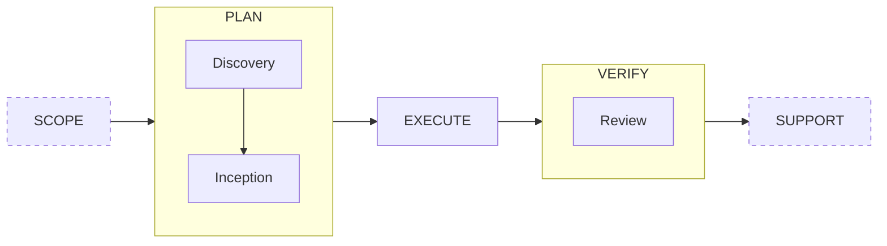

# Loop Engineering Workflow Scaffolding: A lightweight starting point to learn, share, and reuse

This is an example of a lightweight starting point for sharing an AI-augmented development workflow and its harness across teams, products or projects.

--

*Imagine you have grown your workflow and harness (skills, hooks, guardrails, ... ) over time, you are happy with it, and now you want to share that and the related learning with another team member, other teams, or you want to reuse it on a different product, project or codebase.*

*One way of doing that is to replicate the structure of this repo and follow the instructions and the example given. Read below to see how and why. Or jump to the documentation to see an [example](#documentation-the-workflow)*

## How to Share

See how to share your workflow and harness using a repo like this one:

1. Create a repo like this, from scratch or just fork it
1. Document the workflow in the README as in the example below, starting from 'How to Reuse'
1. Detail 'The Workflow' and add a [workflow.yaml](workflow.yaml) file to the repo, with the key workflow details
1. Add your Skills, Hooks, etc. to the repo for every step of the workflow, replicating your agent's folder structure
1. For every Skill, Hook, etc., add only its **skeleton**, the key structure and essential logic; remove the remaining details
1. DO NOT COPY THE WHOLE FILE! In doubt, less is more; nothing is better than too much

## Why

This is why you should share your workflow and harness using a repo like this, with only the **skeleton**, the key structure and essential logic of the various Skills, Hooks, etc., instead of copying them with all their content and details.

### Learning & Evolution

A workflow and its harnesses continuously improve and evolve through ongoing learning. This is indeed what happens in *Loop Engineering*: engineers continuously design, implement, and evolve all the components of the system that guides the agents in getting the work done.

To successfully do this, one needs to understand the workflow and the structure, logic and content of the Skills, Hooks, etc. of each step of the workflow, and how to change, improve, and evolve them. Such solid understanding can be quickly developed starting from a lightweight skeleton containing only key structures and essential logic, and learning to fill the gaps by doing it.

### Sharing

A lightweight structure and essential logic are easier to share between team members and across teams, projects, products, and codebases. They create space for the important conversations and knowledge sharing, whereas the full content of a Skill, for example, would contain too many secondary details, many of which are project, product, and codebase specific and would require editing anyway, therefore becoming a distraction.

### Adaptation

When reusing a workflow and harness on a different project, product or codebase, many specific references to files, commands, domain documentation, etc. need to be identified and replaced.
Approaching the reuse starting from a lightweight skeleton of that workflow and harness makes it much faster to recreate the Skills and harness with help from the AI. This approach is a good way to learn *Loop Engineering* by doing it from the start, as opposed to a copy-paste exercise that works for individual standard skills, hooks, and MCPs, but not for the whole workflow and its harness.

## How to Reuse

These are the instructions for those who want to reuse the workflow, its harness and the learning that comes with it, and want to develop the understanding necessary to reuse it and evolve it.

### Copy the essential harness files and configure your agentic tool

- Copy the relevant Skills, Hooks, etc. into your agent folders (for a specific project or for the whole user)
- Configure the agent tool as needed to enable the Skills, Hooks, etc. you just copied

### Customise the workflow, its steps, and the related harness files

Start by understanding the workflow steps, the key structure and the essential logic of the harness files at each step. As detailed in the instructions below.
Consider the possibility of having a knowledge-sharing conversation directly with the author of the workflow.

- Start by looking at the workflow and its steps documented below
- Inspect and study the content of the Skills, Hooks, etc. for each step of the workflow, and get an understanding of their purpose, structure, logic, and key components
- The first time you actually use the workflow to complete a coding task, at each step of the workflow, tell the agent:
  - to detail and/or change the structure of the related Skills, Hooks, etc. as you want to (for example, choosing if you want the agent to write test-first or after, if you want it to run the whole test suite at every change or only at the end of a step, and so on)
  - to add the relevant guardrails, commands, etc. specific to your project, product, codebase, and style, where and as needed (for example, providing info on how to build, lint, run tests, extract failure reports, use MCPs, etc.)
  - to add references to the relevant documentation for the codebase, infrastructure, environments, domain logic and vocabulary, product design, etc.
  
This is the first step that kicks off your *Loop Engineering* design and implementation, reusing valuable learning through a lightweight scaffolding.

### Engineer the loop

After the initial customisation of the harness, the usual routine of *Loop Engineering* begins.
To help with that, add a 'Retrospective' activity as the last activity of every step of the workflow.

- At the end of every step of the workflow, use the final 'Retrospective' activity to continuously improve the harness: ask the model to make improvements to the harness files based on the learning from that step (what worked, what didn't, and how it got fixed), increasing the flow and autonomy of the loop, the speed and quality of the work, and reducing the effort required.
- Periodically review each workflow step's harness file manually to:
  - remove unnecessary coding-task specific details that tend to slip in and are not relevant for the following tasks, and should be generic to the workflow
  - remove parts you do not agree with
  - crystallise or organise the structure for clarity
  - fix or replace any absolute path with a relative path.

## Documentation: The Workflow

In this example, the core of the workflow is a foundational architectural pattern: Plan-Execute-Verify (or Validate) loop, or *PEV*.

The workflow creates or changes an existing feature, or a slice of a larger feature.
The slice can be horizontal (for example, the NoSQL data access layer, the Lambda layer, the HTTP API layer, or the Frontend layer) or vertical (a usable partial increment of the whole feature).

Read the  [workflow.yaml](workflow.yaml) for an overview of the inputs and outputs of every step.

### Plan

This step takes as input the requirements and specifications of the work to be done. This information could alternatively be pulled from a backlog or provided by the user.
This step leads to the formulation of a plan that the *Execution* step will execute as autonomously as possible.
This step is interactive, with the user pairing with the AI to elicit the required feature and technical specifications and to detail the execution plan.

This Plan step is currently organised into two distinct sub-steps, each with its own skill:

- The first one is a 'Discovery' step to explore one or more implementation strategies, starting from the current codebase, infrastructure, technology, and potentially evaluating different feature designs.
- The second one is an 'Inception' step where decisions are finalised, and the plan is defined.

### Execute

This step is intended to be as autonomous as possible, leaving the developer to focus on other tasks and work without repeated task-switching.

It executes the plan using self-correcting loops directed by the feedback produced by deterministic verification commands such as build, lint, tests, and any other inferential verification against the plan.

### Verify

This step is partially autonomous, for an adversarial review of the generated code and tests, and partially interactive, with the user and AI pairing to manually review the changeset and fix any problems identified.

### Scope and Support

While the core workflow covered here is the *PEV*, advanced workflows may include Scope and Support.

#### Scope

Scope is the AI-augmented product management activity that defines and prioritises the scope.
It may include defining stakeholders, their value objectives, and quantifying the value objectives; drafting the scope that helps achieve those objectives; and creating an impact estimation table to guide the prioritisation of the scope.

The quantified value objectives can be used to numerically evaluate the outcomes produced by the task once released, feeding the loop of a modern evolutionary process.

#### Support

Observability can feed logs from production to an AI agent, which can automatically trigger alerts for high-severity incidents, and can react to run-time errors by automatically creating bug reports fed to the Plan step to start a fix.

## Documentation: The Skills Skeleton and key logic

In this example, there are only skills for the steps in the workflow. Other examples may include a variety of other skills and hooks and MCPs.

### Discovery

*Its purpose is to explore the business-domain concepts and technical implementation details behind a coding task, and persist a Discovery findings report that feeds the Coding Task Inception.*

**Constraint:** read-only — no application code written, no repo tree modified except the report itself.

**Style:** Highly interactive, with the AI pairing with the User

**Input:**

Option 1 — the user provides:

1. **The bigger picture** — which end-user feature or outcome does this coding task serve?
2. **What it contributes to** — how does this task contribute to that?
3. **A high-level description** of the task itself.
4. **What to explore** — which topics should be covered in this Discovery, and which questions need to be answered.

Option 2 — a task reference to retrieve the task from the backlog using an MCP.

**Output:**

- Discovery findings report at `coding-tasks/<slug>/discovery.md`, containing: task framing; agreed topic list (domain and technical, numbered); per-topic findings with evidence (file:line citations, URLs, commands and output); domain concepts glossary; technical implementation details; contradictions and gaps; open questions for inception; dated session log.

**Main steps:**

- Phase 1 — Frame the task: collect the user input.
- Phase 2 — Agree on the topic list: create a domain and technical topic list to be explored, from user input and inferred by the agent; mark highest-risk topics and propose starting there; get explicit agreement before proceeding.
- Phase 3 — Explore and discuss one topic at a time: present findings per topic and wait for user reaction before moving to the next; a topic is done only when findings are detailed enough to act on, not merely plausible; sources include the codebase, live external systems, the web, and repo documentation.
- Phase 4 — The findings report: persist the Discovery report with the findings.
- Phase 5 — Exhaust and verify: ask the user explicitly whether all topics are covered; double-check all findings against the real source; add a short summary at the top; present the final report and wait for confirmation.
- Phase 6 — Retrospect: the agent lists things that went wrong during this step, reflects on how they were fixed, and makes improvements to the skill; ask the user to add any other improvements.
- Standing rules: list of general rules to be followed by the agent during this stage.
- Anti-patterns: list of things the agent should NOT do during the phases of this stage (negative instructions reinforce the positive instructions previously given to the agent in this skill).

### Inception

*Its purpose is to turn a coding task brief into a researched, questioned, confirmed, and persisted implementation plan before any code is written.*

**Constraint:** read-only —  no application code written; plan persisted only after explicit user confirmation.

**Style:** Highly interactive, with the AI pairing with the User

**Input:**

- Discovery findings report at `coding-tasks/<slug>/discovery.md` from the previous step.
- Specification from the user: what to implement, constraints, quality criteria, example files.
- Relevant infrastructure, tech stack, architecture, domain, and verification docs for the relevant parts of the codebase, as referenced by the user or found in the repo.

**Output:**

- Implementation plan at `coding-tasks/<slug>/plan.md`, containing: goal and explicit out-of-scope; decision table with rationale; research findings with file:line citations; sub-task table with Status column (to be done / in progress / done); per-sub-task detail (paths, commands, expected values, why); blocked-by dependency column; review checkpoint tasks; standing assumptions and accepted risks; dated progress log.

**Main steps:**

- Phase 1 — Receive the general information: read all files and references the user names, plus the discovery report; read relevant architecture, domain, and verification docs.
- Phase 2 — Receive the specification: collect what to implement, constraints, quality criteria, and verification approach; note conflicts and gaps for later.
- Phase 3 — Research: verify external data sources live; trace every consumer of every file to be changed; follow call chains to real consumers; check whether design decisions are already documented.
- Phase 4 — Build the plan: create sub-tasks with dependencies; each sub-task must be self-contained with exact paths, verified values, and rationale; sequence verification as a fast inner loop and one authoritative final run; offer review checkpoints at states that compile and run.
- Phase 5 — Question the gaps: ask only questions that change what gets built; treat spec implementation directives as provisional and raise divergences explicitly.
- Phase 6 — Review the plan for completeness, prevent most execution interruptions: walk every sub-task and identify where the executing agent would have to stop; resolve those gaps with the user now to minimise execution interruptions.
- Phase 7 — Present, amend, confirm, persist: present the full plan as a numbered table; invite amendment and wait; fold each round in before re-presenting; persist only after explicit confirmation.
- Phase 8 — Retrospect: review how phases 1–7 went and fold durable improvements back into the skill; ask the user to add any other improvement.
- Standing rules: list of general rules to be followed by the agent during this stage.
- Anti-patterns: list of things the agent should NOT do during the phases of this stage (negative instructions reinforce the positive instructions previously given to the agent in this skill).

### Execution

*Its purpose is to execute the plan as autonomously as possible, using self-correcting verification loops, and produce a work summary report for human review.*

**Constraint:** no commits, no branching — working tree left for the user to stage; sub-tasks executed in dependency order.

**Style:** Semi-autonomous, with the user delegating to the AI

**Input:**

- Implementation plan at `coding-tasks/<slug>/plan.md` from the previous step.
- User confirmation that the pipeline is currently green (baseline).

**Output:**

- Uncommitted working tree changes on the current branch.
- Updated `coding-tasks/<slug>/plan.md` with the Status column updated per sub-task and progress log appended.
- Work summary report at `coding-tasks/<slug>/work-summary.md`, containing one section per completed sub-task: sub-task number and title; files created or modified with reason; verification tier run and result (quoted); items needing human review (judgement calls, deviations, assumptions, brittleness).

**Main steps:**

- Phase 1 — Load and reconcile: read the plan in full; verify sub-tasks marked done cheaply; resolve any in-progress sub-tasks from a prior session before starting new work; confirm a green baseline before changing any code.
- Phase 2 — Order the work: derive execution order from the Blocked-by column; identify unblocked tasks; parallelise code writing only when file sets are disjoint, never verification runs.
- Phase 3 —  Bridge the gaps before you start to limit the interruptions: look ahead across the whole plan and ask the user now about any missing info, decisions, or permissions needed, to minimise interruptions during execution.
- Phase 4 — Execute: for each sub-task in order: mark in progress, do the work, verify, mark done, replace comments with self-explaining code (Phase 7), re-verify, write the work summary entry and post it.
- Phase 5 — Checkpoints: when the plan contains a review checkpoint, stop completely, show what the checkpoint requires, and wait for explicit permission before continuing.
- Phase 6 — Verify before marking done: run the cheapest verification tier that covers the change; prove the test fails before proving it passes, including with mutation testing; triage failures before blaming the change.
- Phase 7 — Replace comments with self-explaining code: replace the comments that the task added or modified with self-explaining names, helpers, and types; re-run verification and expect an identical result.
- Phase 8 — Work summary report: append one section per completed sub-task to `coding-tasks/<slug>/work-summary.md` and share it with the user.
- Phase 9 — Retrospect: review how phases 1–8 went and fold durable improvements back into the skill; ask the user to add any other improvements.
- Standing rules: list of general rules to be followed by the agent during this stage (git discipline, plan drift, scope).
- Anti-patterns: list of things the agent should NOT do during the phases of this stage (negative instructions reinforce the positive instructions previously given to the agent in this skill).

### Review

*Its purpose is to adversarially review the uncommitted work produced by Execution, fix high-priority findings, and hand the user a PR-review guide and a proposed commit message.*

**Constraint:** no commits, no staging, no revert; nothing changed until the user approves a fix plan; only high-priority findings fixed, lower-priority ones noted but not touched; review done inline, no sub-agents.

**Style:** Highly interactive, with the AI pairing with the User

**Input:**

- Implementation plan at `coding-tasks/<slug>/plan.md` from Inception.
- Work summary at `coding-tasks/<slug>/work-summary.md` from Execution.
- Discovery report at `coding-tasks/<slug>/discovery.md` (used for intent reconstruction).
- Uncommitted working tree changes produced by Execution.
- User confirmation that the working tree is green (all tests pass).

**Output:**

- Reviewed and green working tree with approved high-priority fixes applied.
- PR-review guide at `coding-tasks/<slug>/review.md`, containing: what the change does (in app terms); decisions the reviewer would otherwise question (plan decision table, condensed); verification status; findings (high-priority with resolution; noted-not-actioned as a list); reading order index; walkthrough organised under index steps (implementation and related tests per step); what to check manually; riding-along files.
- Proposed commit message (text only — nothing staged or committed).

**Main steps:**

- Phase 0 — Start from green: ask the user to confirm all tests and the full pipeline pass before reviewing anything.
- Phase 1 — Read the diff and reconstruct intent: partition changes into plan-accounted files (reviewed line by line) and riding-along files (named, not reviewed); map each reviewed file to its plan sub-task; read file surroundings, not just the diff.
- Phase 2 — Review adversarially: apply the lenses (code quality and consistency; dependency direction; comment claims; bugs; test quality and coverage; security); run review tools only after the lenses, never before; verify every finding against the real files.
- Phase 3 — Triage, then stop: rank findings as high-priority or noted-not-actioned; present the two-list overview with no ask; then address each high-priority finding one at a time, each in its own message, settling and verifying before moving to the next.
- Phase 4 — Fix: execute the approved fix plan only; verify each fix with the same tier discipline as Execution; nothing from the noted list gets touched.
- Phase 5 — The PR-review guide: persist to `coding-tasks/<slug>/review.md`; draw intent from the persisted files, not memory; post a condensed version in chat with a link.
- Phase 6 — Suggest the commit message: propose text only; do not commit or stage.
- Phase 7 — Retrospect: review how phases 0–6 went and fold durable improvements back into the skill; ask the user to add any other improvement.
- Phase 8 — Close: the working tree is reviewed, green and committable, and the commit message is proposed; it is up to the user to commit.
- Standing rules: list of general rules to be followed by the agent during this stage (git discipline, scope, honesty over reassurance, read-only commands only).
- Anti-patterns: list of things the agent should NOT do during the phases of this stage (negative instructions reinforce the positive instructions previously given to the agent in this skill).
